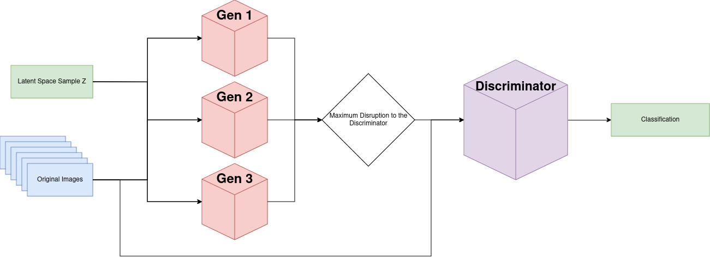

# DefendaGAN

Adversarial training of an image classifier against a *learned* attacker: a group of generator
networks learns to perturb images so the classifier misclassifies them, while the classifier learns
to stay correct on both clean and perturbed images. The goal is a classifier that is more robust to
standard gradient attacks (FGSM, PGD) than one trained on clean data alone.



## How it works

The setup is GAN-shaped, but the "discriminator" is a 10-class classifier rather than a real/fake
judge.

- **Generators** (`GeneratorNet`, grouped in `GeneratorNetGroup`): each takes an image plus uniform
  noise and outputs an additive perturbation. The adversarial image is `image + perturbation`.
  - Loss: MSE between the classifier's output and an "anything but the true class" target, set by
    `GEN_LOSS` (`even`, `target`, `easiest`, `easiest_exp`).
  - `REGULARIZATION` adds an L2 penalty on the size of the perturbation. With `VARY_REG`, each
    generator gets its own penalty strength, spaced logarithmically from 1e-3 to 1e-8. This gives a
    spread from subtle to aggressive attackers.
  - With more than one generator, a diversity term (`DIVERSITY_TYPE` = `KL` or `cosine`, scaled by
    `KL_WEIGHT`) pushes the generators toward producing different perturbations.
- **Discriminator** (`DiscriminatorNet`): a small CNN classifier with two conv blocks and two FC
  layers. Each step it trains on the clean batch plus the perturbed batch from **whichever generator
  hurts it most** (worst-of-N), using label-smoothed cross-entropy.
- **Training schedule**: by default the discriminator steps first and the generators second.
  - `TRAINING_ALTERNATE` flips that order when the generators are losing.
  - `TRAIN_GEN_MAX` keeps training the generators on a batch until the classifier's accuracy on it
    drops below 80%.
  - `DISABLE_ATTACK` turns the generators off and trains a plain classifier as a baseline.
- **Evaluation**: during training, every `BATCH_SIZE` batches (128 by default), the following are
  logged to Weights & Biases on a test batch:
  - clean accuracy;
  - min and max accuracy under the generators' perturbations;
  - accuracy under FGSM (ε = 0.03) and PGD (ε = 0.03, α = 0.005, 100 steps), from `comparison.py`.

## Repository layout

| File | Purpose |
|---|---|
| `network.py` | Models, losses and the training loop. **Entry point**: `python network.py` |
| `config.py` | Every experiment knob, as module-level constants with inline docs. Edit it before a run |
| `dataset.py` | MNIST / CIFAR-10 loaders (normalised to [-1, 1]). Auto-download to `./dataset` |
| `comparison.py` | Reference attacks: FGSM, PGD (untargeted and targeted), constant/random noise, Carlini-Wagner (via `torchattacks`) |
| `utils.py` | TensorBoard `Logger`, `save_model` / `load_model` (which handle generator groups) |
| `visualize.py` | Plots a single digit with its prediction |
| `test_baseline.py` | Runs FGSM against a plain MNIST classifier (`models/baseline_mnist.pth`) |
| `test_discriminator.py` | Runs CW / FGSM / PGD against a saved discriminator |
| `test_generator.py` | Runs a saved generator against a baseline classifier and a saved discriminator |

The `test_*.py` files are evaluation scripts, not unit tests. They contain hard-coded checkpoint
paths, so edit those before running them.

## Setup

Requires Python 3.10. A CUDA GPU is optional (see Known issues).

```bash
python -m venv .venv
source .venv/bin/activate
pip install -r requirements.txt
wandb login            # or: export WANDB_MODE=offline
```

## Running an experiment

1. Edit `config.py`. The current defaults are CIFAR-10, 5 generators, KL diversity (`KL_WEIGHT=0.1`),
   `even` generator loss and 20 epochs.
2. Run training:

   ```bash
   python network.py
   ```

3. Follow the run in the `DefendaGAN` W&B project. TensorBoard scalars and image grids also go to
   `./runs` (view them with `tensorboard --logdir runs`).
4. At the end, the models are saved to the repo root as `generator_<wandb-run-name>.pth` and
   `discriminator_<wandb-run-name>.pth`. A generator checkpoint is a list of state dicts, one per
   generator. Load it with:

   ```python
   import network, utils
   gen = utils.load_model(network.GeneratorNetGroup(N, img_in_channels=3), "generator_<run>.pth")
   disc = utils.load_model(network.DiscriminatorNet(3), "discriminator_<run>.pth")
   ```

   For CIFAR-10, set `config.Z_SHAPE = (3, 32, 32)` before loading. `run()` sets it automatically
   during training.

Datasets, checkpoints, `wandb/` and `runs/` are git-ignored. Keep results in W&B, or move the
checkpoints you care about into `models/`.

## Known issues

These are carried over from the notes in `config.py` and from reading the code:

- **The models never move to the GPU.** `DEVICE` is computed but never applied: neither the models
  nor the batches are moved to it, and `test_batch.to(DEVICE)` discards its result. Training runs
  on the CPU.
- **`GEN_LOSS = "easiest"` and `"easiest_exp"` crash.** They read `prediction` before it is
  assigned in `GeneratorNet.train_g`.
- **`VARY_REG = False` breaks multi-generator runs.** `varied_reg` is then undefined when
  `N_GENERATOR > 1`.
- `KL_WEIGHT_SCHEDULE` and `INPUT_TYPE = "image"` are not implemented yet.
- **Open research questions:**
  - With `DISABLE_ATTACK = True`, the baseline classifier is unexpectedly robust.
  - `TRAINING_ALTERNATE` and the choice of `GEN_LOSS` make little measurable difference.
- `test_*.py` and `visualize.py` still assume MNIST (28×28 grayscale).

## Authors

[SavvySpiro](https://github.com/SavvySpiro) and hanjzh.
